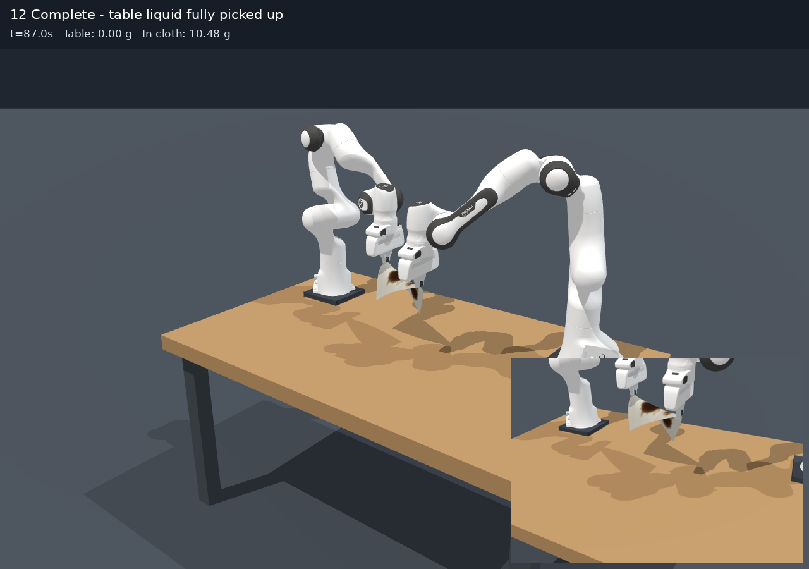
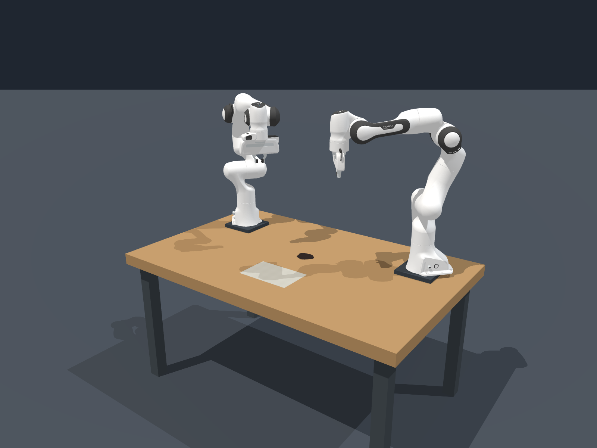
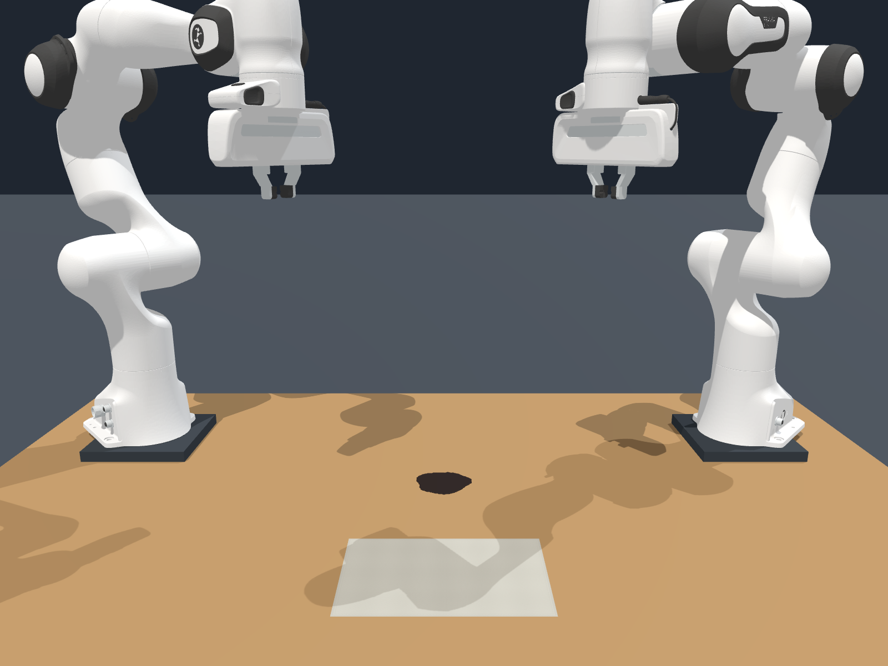
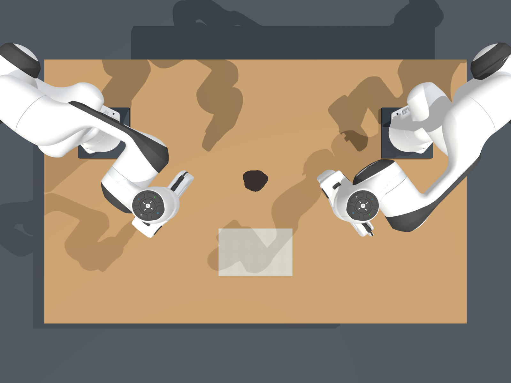
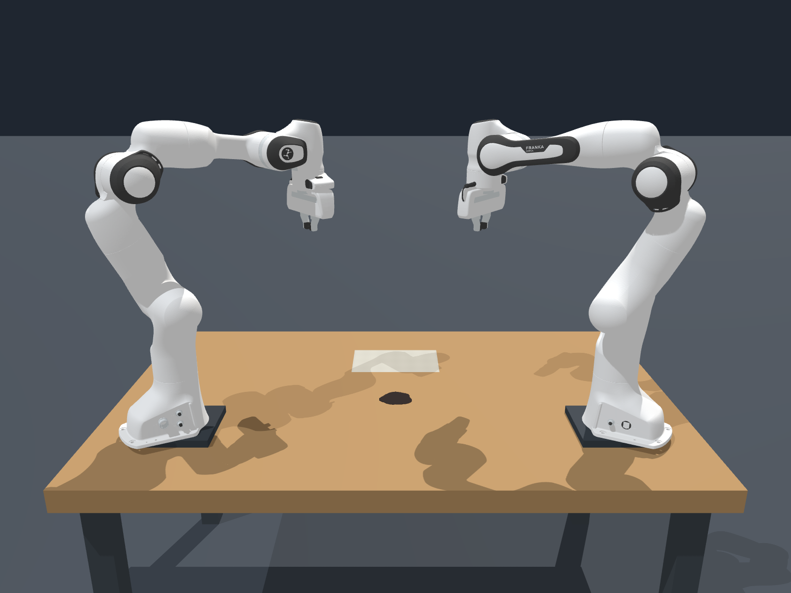

# 双 Franka 棉布吸液与擦拭仿真

本仓库保存本地 Genesis 仿真的完整源码、实际使用的物理参数、双臂控制、吸液耦合、测试和结果。场景包含桌子、两台 Franka Panda、可流动酱油与长方形棉布。

**动作流程：张开接近布料对角 → 接触后闭合 → 双臂提布并铺到酱油上 → 按压及往返擦拭 → 全部吸收 → 再次夹取、提起湿布。**

[观看完整中文视频](results/contact_first_full/continuation_review/cotton_contact_first_full_cn.mp4) · [下载全部源码与原始仿真数据](https://github.com/Chloe-Jinlei/genesis-dual-franka-cotton-wiping/releases/tag/simulation-2026-11-12) · [安装与复现](docs/REPRODUCING.md)



## 初始场景的四个视角

四张图片均来自同一个动作前初态：仿真开始后静置 **0.5 s**，棉布已落稳，双臂尚未开始抓取。物理参数与完整仿真一致，仅改变相机位置；每张图片为 **1600 × 1200 PNG**，无字幕、无画中画。

| 斜侧全景 | 正面近景 |
| --- | --- |
|  |  |

| 俯视 | 背面 |
| --- | --- |
|  |  |

[下载四张原图](results/initial_views/)；这组图片在首次 Release 归档后新增，直接保存在仓库中。

## 本次运行结果与边界

使用当前“先接触、后闭合”的控制器，从干布初态开始，完成 **6 轮擦拭**。1489 份酱油、共 **10.48256 g** 全部吸收，自由液体为 0；湿布质量 **19.55456 g**。生产动作于 **87.05 s** 完成，再保持 **4 s**，最终物理时间 **91.05 s**。完整原速视频约 91.023 秒。

运行曾被用户中断，在 **38.7 s** 完整物理检查点恢复；恢复边界的原生状态和生产代码独立核验一致。视频只保留本轮有效前缀和恢复后的后缀，排除了中断支线，**并非一次不中断执行**。

- 16 项任务要求通过；四次抓取均先接触再闭合，原抓取门限通过后主提起。
- 完成与保持结束时，四个指垫的支持节点数均为 **2、5、7、2**，额外终态接触检查通过。
- **严格材料检查未通过**：原总结果为 **17/19，`passed=false`**。湿布提起时，经/纬局部伸长峰约 2.725%/3.142%，超过原 2.2% 阶段门限。
- **66.5 s 第五轮擦拭出现局部最大边伸长 100.588%**，不能用主体布面外观或低 P99 指标掩盖此瞬态。第一次换区时，一个指垫还曾只有 1 个支持节点，额外“全程每指至少 2 点”检查未通过。
- 棉布与吸液是未实验标定的工程近似；抓取采用接触门控的理想无滑移约束，未验证真实力闭合。

[完整验证汇总](results/contact_first_full/completion_validation.json)、[独立审计结论](results/contact_first_full/run_02/independent_conclusions.json)、[局部瞬态记录](results/contact_first_full/run_02/sampled_material_transients.json)、[四次抓取审计](results/contact_first_full/four_grasps_final_review.json) 均保留原结论。

## 仓库与完整归档

| 位置 | 内容 |
| --- | --- |
| `soy_cloth_scene/` | 原样保存的场景源码、配置、资产、测试、历史代码备份及材料说明 |
| `genesis-world/` | Genesis 官方子模块，固定 commit `ffd119c30118ebb9745fc009349efb2112a8cb76`，版本 1.4.3 |
| `results/contact_first_full/` | 最新完整视频、关键图和主要验证报告 |
| `references/` | 用户提供的材料 PDF 与夹爪问题参考截图 |
| `requirements-lock.txt`、`environment.json` | 实际运行环境的依赖版本与记录 |
| `packaging/` | 文件哈希、引擎源文件清单、完整归档清单和必要 CPU 测试历史样本索引 |
| Release 完整包 | 上述复现文件，以及**全部**历史输出、原始日志、视频、状态检查点、轨迹数组、审计工具和报告 |

完整包包含场景所有非缓存文件，不仅是最后一轮；失败试验和历史材料版本同样保留。原始 `soy_cloth_scene/output/` 约 1.9 GB，不直接放进 Git 历史，而作为同一仓库的 Release 附件。Git 内另收录 5 个小型历史测试样本，因此 CPU 测试无需下载全量数据。

完整包还包含固定版本 Genesis 的源文件，解压后无需再次下载引擎源码；安装 Python 依赖仍需网络。`.venv`、GPU 编译缓存、Python/Numba 缓存和机器级安装不打包，使用记录的版本重建。

原始报告、检查点和长篇研究说明保留了本机来源路径，没有改写取证文件或旧哈希。新机器运行请使用本 README 与 [复现说明](docs/REPRODUCING.md)；跨机器重做历史审计需按说明处理旧路径。生产配置里的原 PDF 绝对路径仅是来源元数据，不用于加载材料文件。

## 快速运行

```bash
git clone --recurse-submodules https://github.com/Chloe-Jinlei/genesis-dual-franka-cotton-wiping.git
cd genesis-dual-franka-cotton-wiping
./setup.sh
./run-soy-cloth.sh --robot-wipe --record --headless
```

重跑本次完整记录及额外 4 秒保持：

```bash
./run-complete.sh --output soy_cloth_scene/output/my_complete_run --hold 4
```

输出目录必须为空。显示交互窗口可运行 `./run-soy-cloth.sh --robot-wipe --hold-open`。物理仿真比视频时间慢，GPU、驱动和安装要求详见 [复现说明](docs/REPRODUCING.md)。本次打包保持生产代码和物理参数不变，不保证不同硬件逐位一致。

## 来源与许可

参见 [第三方来源](THIRD_PARTY.md)。Genesis 与其机器人资产保留各自上游许可。用户提供的参考文档单独保留，不将其解释为仿真已完成实物材料标定。仓库未替用户另行授予自有代码或参考材料的开源许可。
